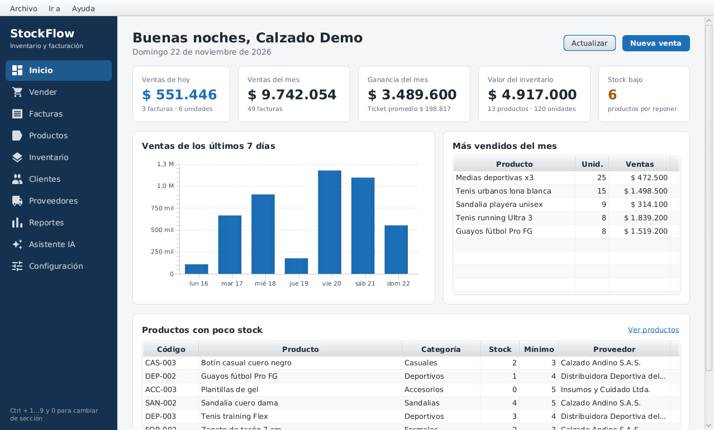
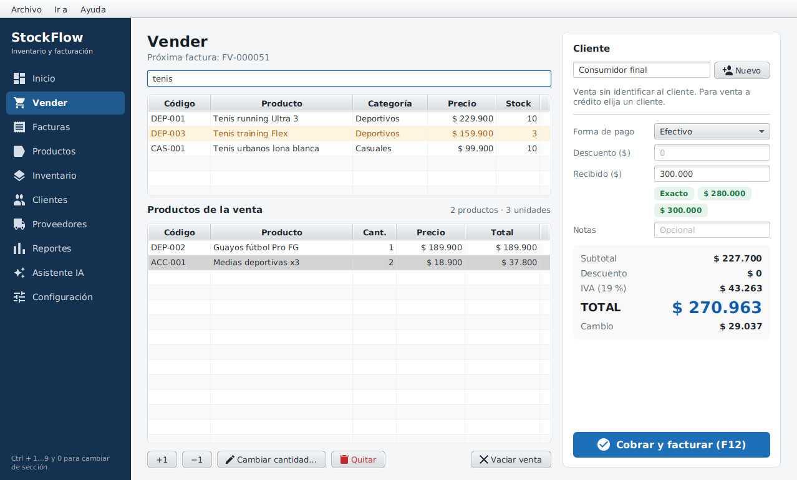
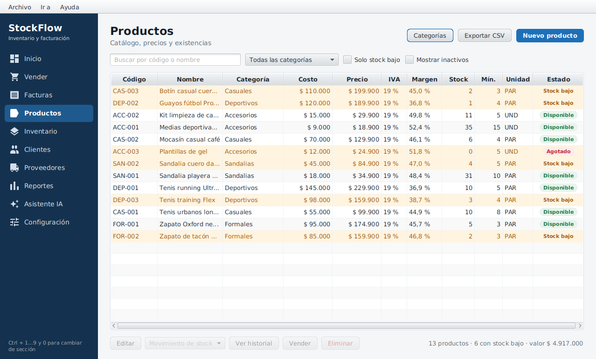
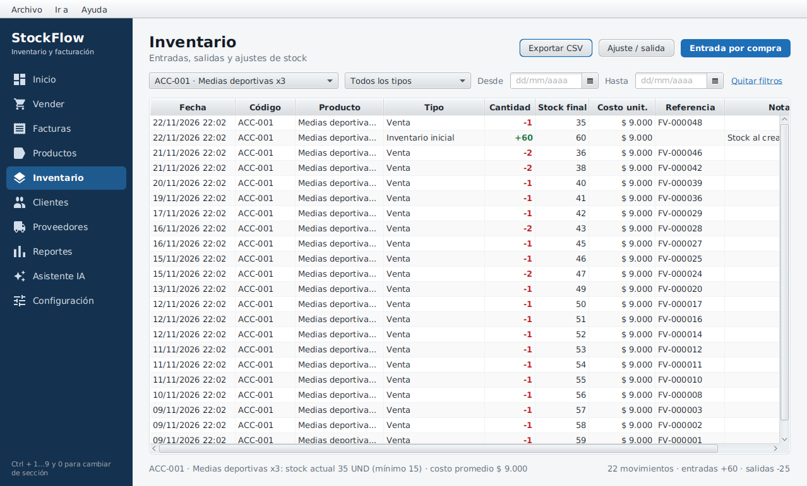
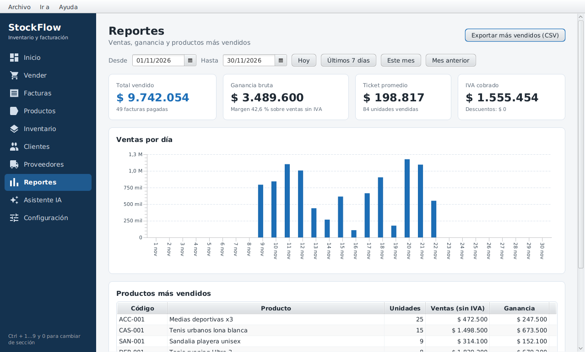
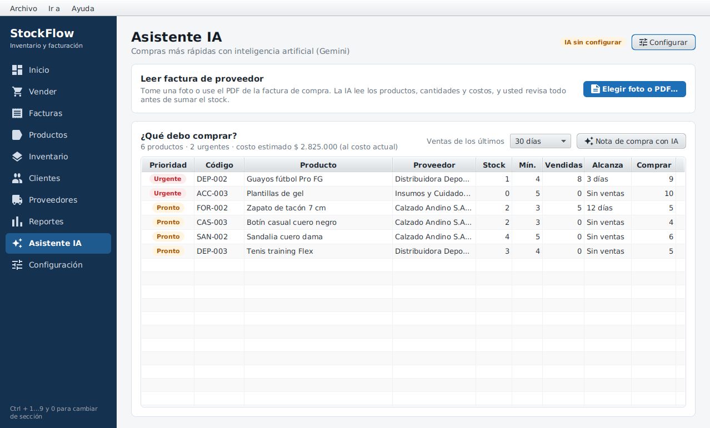
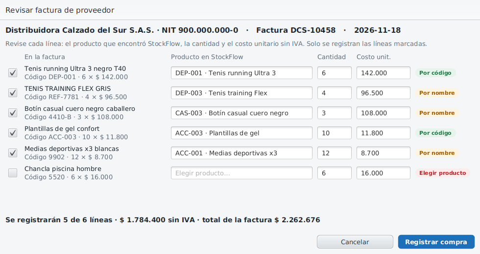

# StockFlow · Inventario y facturación

Aplicación de escritorio para **controlar el inventario y facturar las ventas** de un negocio pequeño
(tienda de calzado, papelería, miscelánea…). Funciona **sin internet** en Windows, macOS y Linux, y
guarda los datos en el mismo equipo; solo el asistente de inteligencia artificial necesita conexión.



**Descargar:** el instalador de cada sistema está en
[Releases](https://github.com/LeiderCadena2110/App_Escritorio/releases) (`.exe` para Windows,
`.dmg` para macOS, `.deb` y AppImage para Linux). No necesita instalar Java.

## Funcionalidades

- **Panel principal:** ventas del día y del mes, ganancia, valor del inventario, ventas de los últimos
  7 días, productos más vendidos y productos con poco stock.
- **Productos y categorías:** código (SKU), precio de costo y de venta, margen, stock y stock mínimo,
  búsqueda, filtros y exportación a CSV.
- **Inventario:** entradas por compra (con costo promedio ponderado), ajustes, pérdidas y devoluciones,
  con el historial (kardex) de cada producto.
- **Punto de venta:** carrito con búsqueda por código o lector de barras (sin importar tildes), cliente
  con sugerencias, botones de pago rápido en efectivo, control de stock, descuento, IVA y cambio.
  Atajos F2 (buscar), F3 (cliente) y F12 (cobrar).
- **Facturas:** consecutivo con prefijo (`FV-000001`), detalle, exportación a **PDF** y anulación que
  devuelve las unidades al inventario.
- **Clientes y proveedores.**
- **Reportes:** ventas por periodo, ganancia, ticket promedio, IVA cobrado, ventas por día y más vendidos.
- **Configuración:** datos del negocio, régimen e IVA por producto, numeración de facturas y tema claro u oscuro.
- **Asistente IA (Gemini):** lee la foto o el PDF de una factura de proveedor y prepara la compra
  para revisar; calcula qué productos comprar y cuántos, y redacta la nota de pedido por proveedor.

| Vender | Productos |
|---|---|
|  |  |
| **Inventario** | **Reportes** |
|  |  |
| **Asistente IA** | **Factura de proveedor leída con IA** |
|  |  |

Ejemplo de factura generada: [`samples/sample-invoice.pdf`](samples/sample-invoice.pdf).

## Tecnología

| Capa | Herramienta |
|---|---|
| Lenguaje | Java 21 LTS |
| Interfaz | JavaFX 21 (vistas FXML + CSS) |
| Servicios | Spring Boot 3 (sin servidor web) |
| Datos | Spring JDBC + H2 (archivo local) + Flyway |
| PDF | Apache PDFBox |
| IA | Google Gemini (API REST, salida JSON estructurada) |
| Pruebas | JUnit 5 + Spring Boot Test |
| Instaladores | jpackage (`.exe`, `.dmg`, `.deb`, AppImage) |

## Estructura del proyecto

Monolito modular con arquitectura hexagonal (puertos y adaptadores): un módulo por funcionalidad,
y dentro de cada uno las capas `domain`, `application`, `infrastructure` y `ui`.

```
src/main/java/co/edu/ucc/stockflow/
├── app/          Ventana principal y menú
├── shared/       Errores, dinero/fechas, componentes de interfaz
├── settings/     Datos del negocio, IVA, consecutivos
├── catalog/      Productos, categorías, proveedores
├── customers/    Clientes
├── inventory/    Movimientos de stock
├── sales/        Facturas, IVA, pagos, punto de venta, PDF
├── reporting/    Inicio y reportes
└── assistant/    Asistente IA: plan de compras y facturas de proveedor (Gemini)
```

Las reglas de capas y dependencias entre módulos se verifican en cada build con `ArchitectureTest`.
Los detalles están en [`docs/architecture.md`](docs/architecture.md).

## Cómo ejecutarla

Requisitos: **JDK 21** (por ejemplo, Eclipse Temurin). Maven descarga JavaFX y las demás librerías.

**IntelliJ IDEA**

1. *File › Open* y elija la carpeta del proyecto (la que tiene `pom.xml`).
2. *File › Project Structure › SDK*: elija Java 21.
3. Espere a que Maven descargue las librerías.
4. Abra `src/main/java/co/edu/ucc/stockflow/Launcher.java` y pulse ▶ junto a `main`.

**Terminal**

```bash
mvn spring-boot:run          # la primera vez, o tras cambiar de rama: mvn clean spring-boot:run
```

> Ejecute siempre **Launcher**, no `DesktopApp`: si se ejecuta directamente la clase que extiende
> `Application`, Java muestra "JavaFX runtime components are missing".

La app empieza vacía. Para probarla con un catálogo de tienda de calzado (13 productos, clientes y
proveedores) use **Ayuda › Cargar datos de ejemplo**. Los datos quedan en `~/.stockflow/` (carpeta
`.stockflow` del usuario).

Para el **Asistente IA** cree una clave gratuita en [Google AI Studio](https://aistudio.google.com/apikey)
y péguela en *Asistente IA › Configurar* (o defina la variable de entorno `GEMINI_API_KEY`).

## Pruebas

```bash
mvn test
```

Más de 110 pruebas, todas sin internet:

- **unitarias** de dominio: dinero, fechas, agregado `Invoice`, IVA, formas de pago, stock, plan de compras;
- **de integración** sobre H2 en memoria: vender → anular, y leer factura con IA → registrar compra
  (con un modelo de IA falso);
- **del adaptador de Gemini** contra un servidor HTTP local que lo imita;
- **de arquitectura** (`ArchitectureTest`): capas y dependencias entre módulos.

GitHub Actions las ejecuta en cada `push`.

## Instaladores

```bash
mvn package                          # crea target/app
packaging/build-linux.sh             # .deb y AppImage
packaging/build-macos.sh             # .dmg (en un Mac)
packaging\build-windows.bat exe      # .exe (en Windows, con WiX 3.14)
```

También se pueden generar en GitHub: *Actions › Build installers › Run workflow*.

## Documentación

- [Propuesta y reglas de negocio](docs/proposal.md)
- [Arquitectura y estructura de carpetas](docs/architecture.md)
- [Manual de uso](docs/user-guide.md)

---

Proyecto académico · Universidad Cooperativa de Colombia, sede Pasto · Ingeniería de Software.
