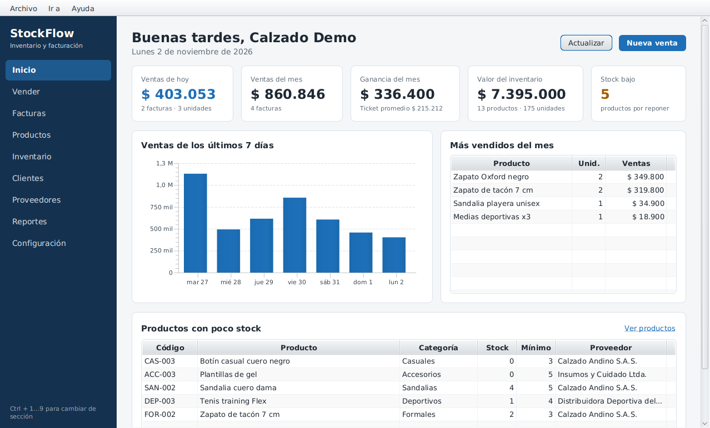
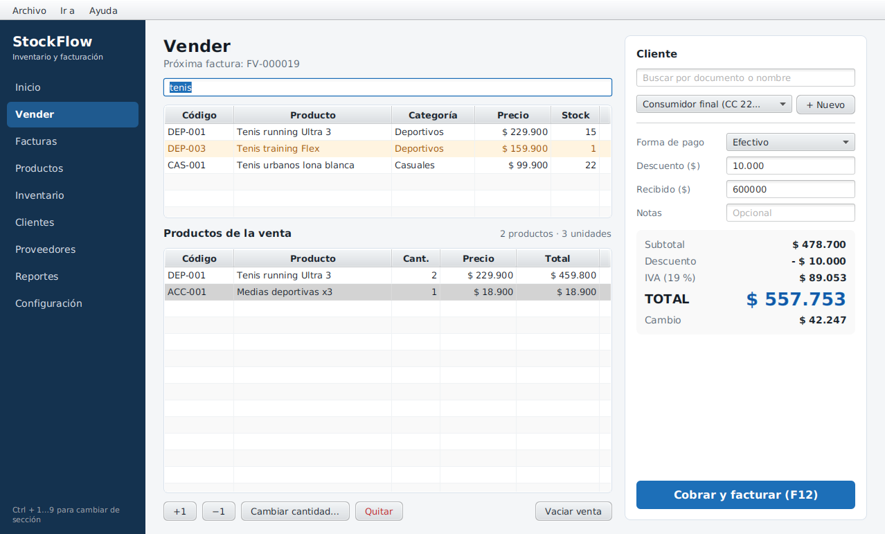
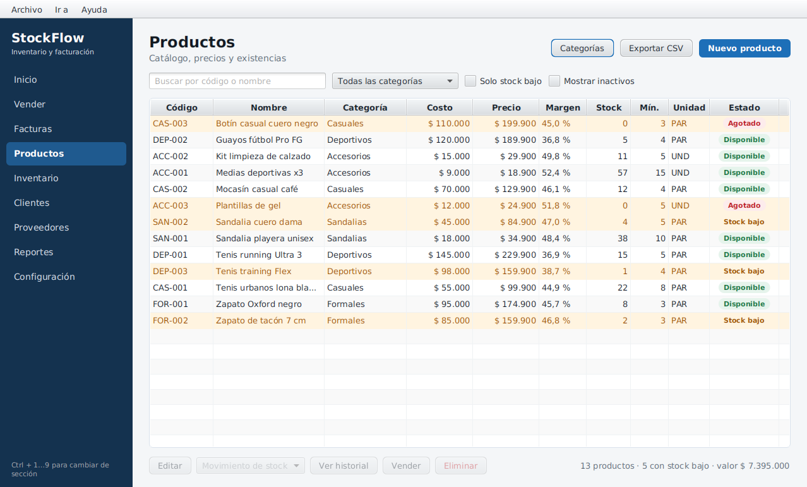
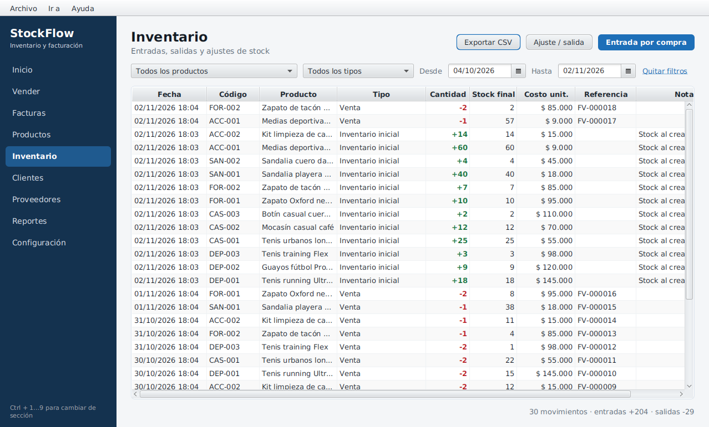
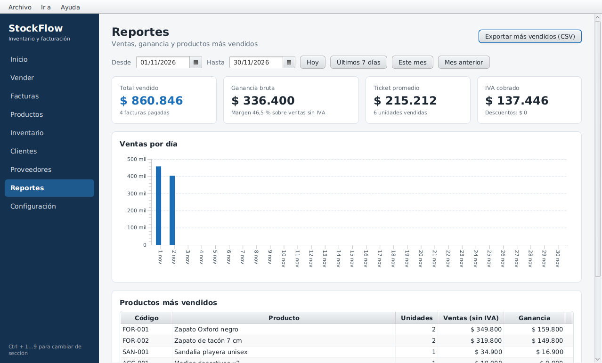

# StockFlow · Inventario y facturación

Aplicación de escritorio para **controlar el inventario y facturar las ventas** de un negocio pequeño
(tienda de calzado, papelería, miscelánea…). Funciona **sin internet** en Windows, macOS y Linux, y
guarda los datos en el mismo equipo.



## Funcionalidades

- **Panel principal:** ventas del día y del mes, ganancia, valor del inventario, ventas de los últimos
  7 días, productos más vendidos y productos con poco stock.
- **Productos y categorías:** código (SKU), precio de costo y de venta, margen, stock y stock mínimo,
  búsqueda, filtros y exportación a CSV.
- **Inventario:** entradas por compra (con costo promedio ponderado), ajustes, pérdidas y devoluciones,
  con el historial (kardex) de cada producto.
- **Punto de venta:** carrito con búsqueda por código, control de stock, descuento, IVA, forma de pago
  y cambio. Atajos F2 (buscar) y F12 (cobrar).
- **Facturas:** consecutivo con prefijo (`FV-000001`), detalle, exportación a **PDF** y anulación que
  devuelve las unidades al inventario.
- **Clientes y proveedores.**
- **Reportes:** ventas por periodo, ganancia, ticket promedio, IVA cobrado, ventas por día y más vendidos.
- **Configuración:** datos del negocio, % de IVA, numeración de facturas y tema claro u oscuro.

| Vender | Productos |
|---|---|
|  |  |
| **Inventario** | **Reportes** |
|  |  |

Ejemplo de factura generada: [`samples/sample-invoice.pdf`](samples/sample-invoice.pdf).

## Tecnología

| Capa | Herramienta |
|---|---|
| Lenguaje | Java 21 LTS |
| Interfaz | JavaFX 21 (vistas FXML + CSS) |
| Servicios | Spring Boot 3 (sin servidor web) |
| Datos | Spring JDBC + H2 (archivo local) + Flyway |
| PDF | Apache PDFBox |
| Pruebas | JUnit 5 + Spring Boot Test |
| Instaladores | jpackage (`.exe`, `.dmg`, `.deb`, AppImage) |

## Estructura del proyecto

```
├── docs/                 Documentación (propuesta, arquitectura, manual, capturas)
├── packaging/            Scripts e íconos para crear los instaladores
├── samples/              Ejemplos de archivos que genera la app (PDF, CSV)
└── src/
    ├── main/java/co/edu/ucc/stockflow/
    │   ├── model/        Entidades: Product, Invoice, Customer…
    │   ├── dto/          Registros para reportes
    │   ├── exception/    Errores de negocio
    │   ├── repository/   Acceso a datos (SQL)
    │   ├── service/      Reglas de negocio
    │   ├── util/         Dinero, fechas y formatos
    │   └── ui/           Interfaz: controller/, dialog/, component/
    ├── main/resources/   views/ (FXML), styles/ (CSS), db/migration/ (SQL), icons/
    └── test/java/        Pruebas
```

El detalle de las capas, el modelo de datos y las convenciones de nombres está en
[`docs/architecture.md`](docs/architecture.md).

## Cómo ejecutarla

Requisitos: **JDK 21** (por ejemplo, Eclipse Temurin). Maven descarga JavaFX y las demás librerías.

**IntelliJ IDEA**

1. *File › Open* y elija la carpeta del proyecto (la que tiene `pom.xml`).
2. *File › Project Structure › SDK*: elija Java 21.
3. Espere a que Maven descargue las librerías.
4. Abra `src/main/java/co/edu/ucc/stockflow/Launcher.java` y pulse ▶ junto a `main`.

**Terminal**

```bash
mvn spring-boot:run
```

> Ejecute siempre **Launcher**, no `DesktopApp`: si se ejecuta directamente la clase que extiende
> `Application`, Java muestra "JavaFX runtime components are missing".

La primera vez se crea un catálogo de ejemplo de una tienda de calzado para probar la app. Los datos
quedan en `~/.stockflow/` (carpeta `.stockflow` del usuario).

## Pruebas

```bash
mvn test
```

Incluyen pruebas unitarias (dinero, fechas, totales de factura, reglas de stock, CSV) y una prueba de
integración del flujo completo vender → anular sobre una base H2 en memoria.

## Instaladores

```bash
mvn package                          # crea target/app
packaging/build-linux.sh             # .deb y AppImage
packaging/build-macos.sh             # .dmg (en un Mac)
packaging\build-windows.bat exe      # .exe (en Windows, con WiX 3.14)
```

También se pueden generar en GitHub: *Actions › Build installers › Run workflow*.

## Documentación

- [Propuesta y reglas de negocio](docs/proposal.md)
- [Arquitectura y estructura de carpetas](docs/architecture.md)
- [Manual de uso](docs/user-guide.md)

---

Proyecto académico · Universidad Cooperativa de Colombia, sede Pasto · Ingeniería de Software.
